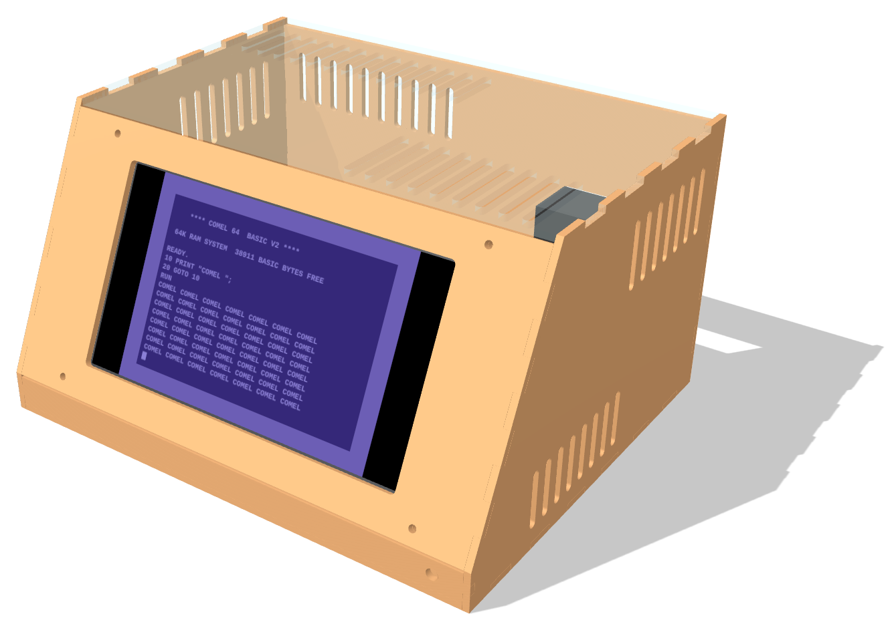
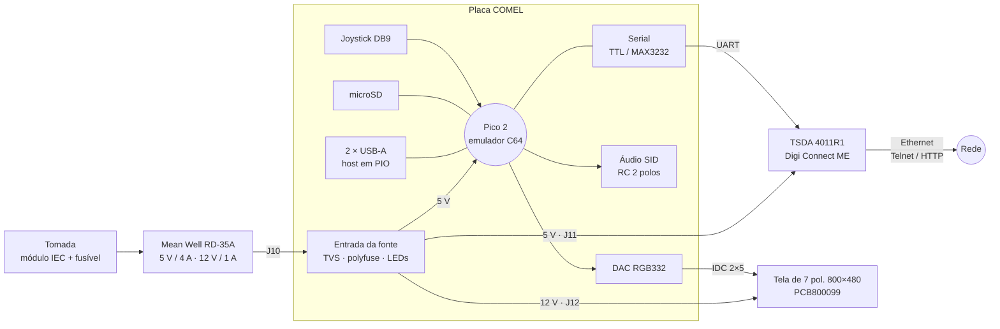
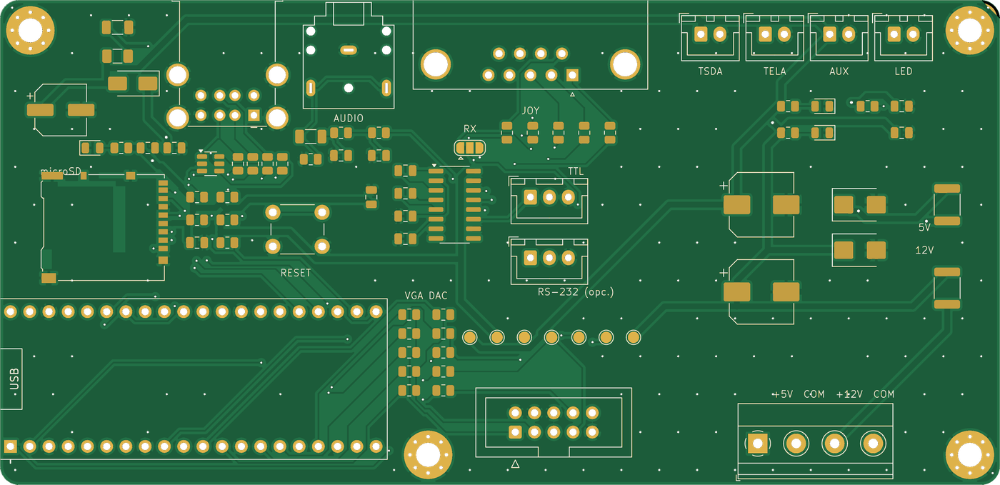
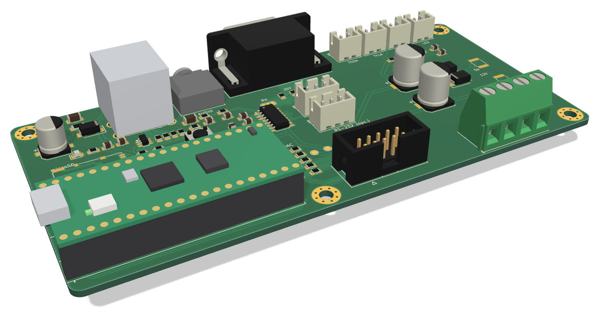
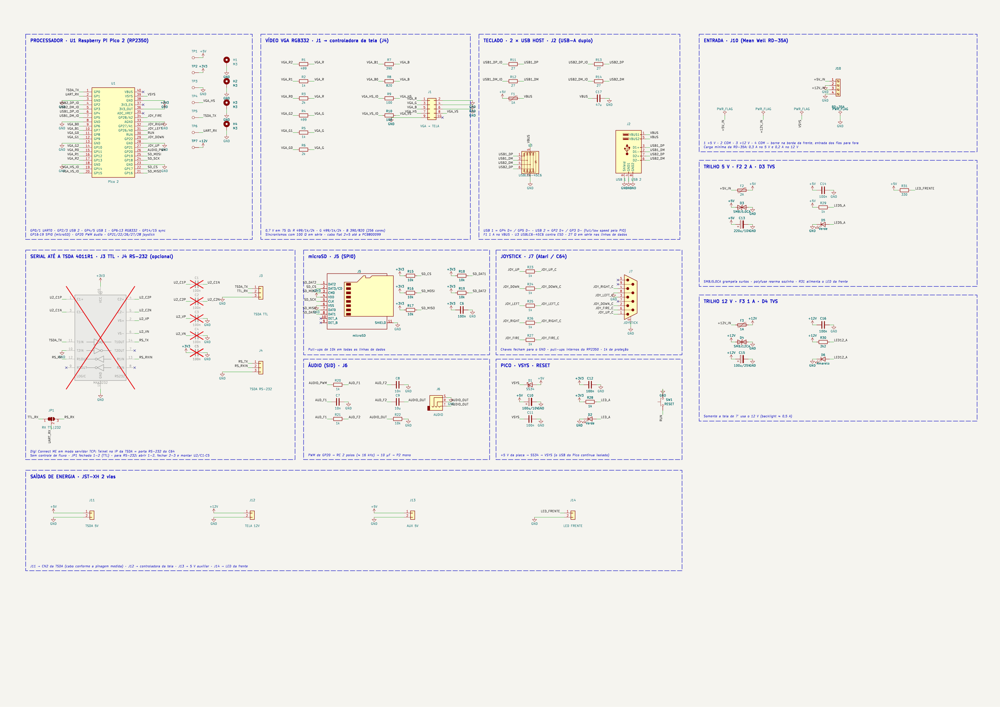
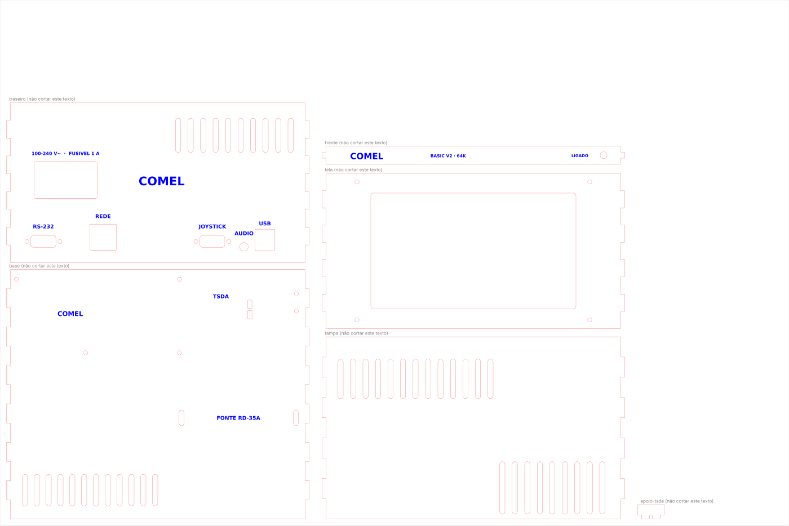
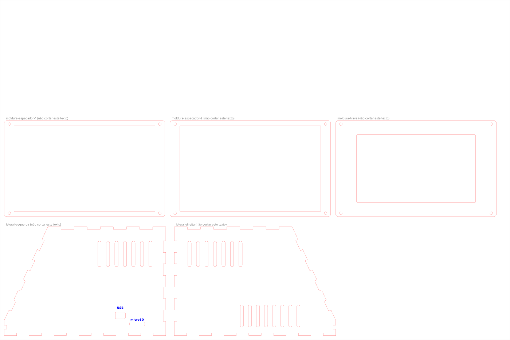
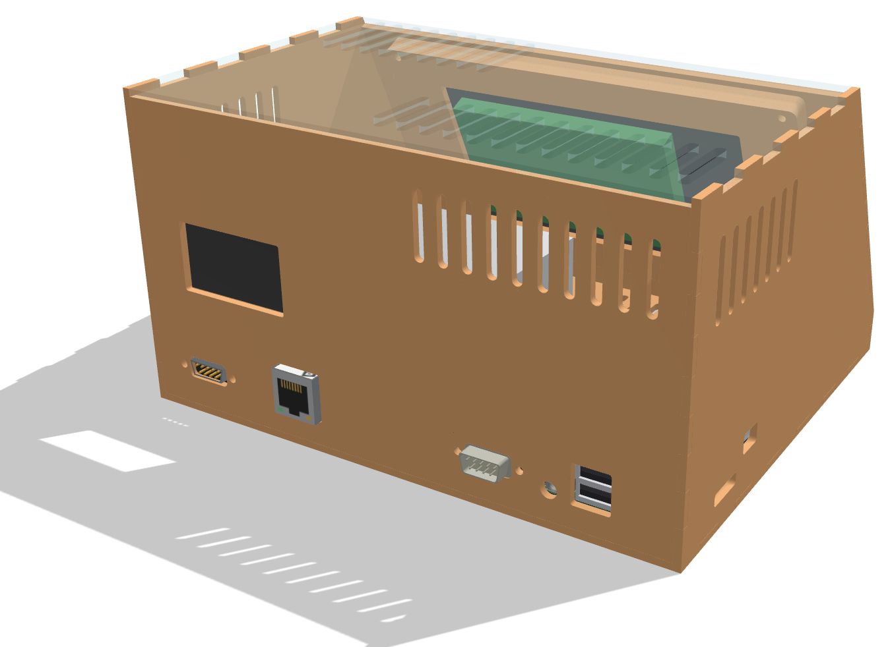
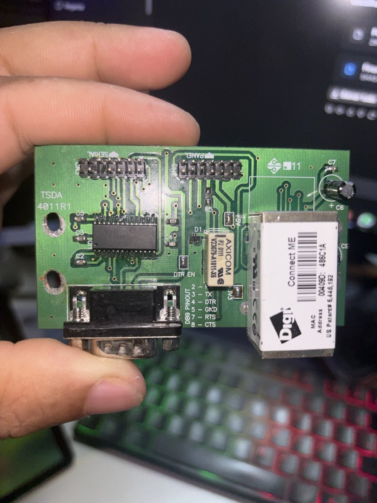

<p align="center">
  
</p>

<p align="center">
  
  
  
  
  
  
</p>

<p align="center">
  <b>Um Commodore 64 de verdade — BASIC V2, tela de 7" VGA, 2 portas USB para teclado e joystick — ligado à rede por uma TSDA 4011R1.</b><br>
  Uma placa única em KiCad (esquemático, PCB roteada, arquivos de fábrica, 3D com componentes reais),<br>
  a engenharia reversa da TSDA e uma carcaça compacta com a tela inclinada, pronta para cortar a laser.
</p>

<p align="center">
  <a href="https://aragonxpd154.github.io/COMEL/"></a>
</p>

---

## Sumário

- [Visão geral](#visão-geral)
- [Arquitetura](#arquitetura)
- [Placa COMEL](#placa-comel--o-commodore-e-a-energia-numa-placa-só)
- [Carcaça cortada a laser](#carcaça-cortada-a-laser)
- [TSDA 4011R1 — a placa de rede](#tsda-4011r1--a-placa-de-rede)
- [Lista de materiais](#lista-de-materiais)
- [Guia passo a passo](#guia-passo-a-passo)
- [Estrutura do repositório](#estrutura-do-repositório)
- [Limitações e pontos a confirmar](#limitações-e-pontos-a-confirmar)
- [Referências](#referências) · [Licença](#licença)

---

## Visão geral

A **TSDA 4011R1** é a placa de comunicação da remota FLEX TSDA usada na transmissão: um Digi Connect ME que coloca uma
porta serial na rede. Este projeto aproveita essa placa como "modem" de um **Commodore 64 recriado num Raspberry Pi
Pico 2**: o Pico emula o C64 (6502, VIC-II, SID, KERNAL e BASIC V2), mostra a imagem numa tela de 7" VGA e fala com a
TSDA pela serial. Um Telnet no IP da TSDA conversa com o programa BASIC, como uma BBS dos anos 80.

| | Conteúdo | Onde |
|---|---|---|
| 🟦 | **Placa COMEL** — Pico 2, VGA RGB332, 2 × USB host (teclado), microSD, áudio (SID), joystick, serial até a TSDA **e** a entrada da Mean Well RD-35A (5 V / 12 V) com TVS, polyfuse e LED por trilho. 132 × 64 mm, **DRC 0** | [`hardware/comel`](hardware/comel) |
| 🏭 | Gerbers X2, furação, BOM, pick-and-place, STEP, PDFs de esquemático e montagem | [`hardware/comel/fab`](hardware/comel/fab) |
| 📦 | Carcaça compacta (230 × 128 × 190 mm) com a tela de 7" inclinada 25°, chapa de 3 mm: 2 chapas de 600 × 400 mm em **SVG e DXF**, gerada a partir do layout da placa | [`case`](case) |
| 🔍 | Engenharia reversa da TSDA 4011R1, com modelo 3D reconstruído das fotos | [`docs/tsda-4011r1.md`](docs/tsda-4011r1.md) |
| 🧊 | Modelos 3D (STEP/GLB/STL) e visualizador three.js com a montagem completa | [`docs/3d`](docs/3d) |
| 💾 | **Firmware do C64** pronto para gravar ([`comel.uf2`](firmware/bin/comel.uf2)): 6510/VIC-II/CIAs/SID, VGA 640×480 em PIO, 2 × USB host para teclado, áudio PWM, LOAD/SAVE no microSD | [`firmware`](firmware) |
| 🔁 | Pipeline reprodutível: um arquivo Python descreve os circuitos; o resto é gerado | [`tools/eda/designs.py`](tools/eda/designs.py) |

---

## Arquitetura



---

## Placa COMEL — o Commodore e a energia numa placa só

<table>
<tr>
<td width="50%"></td>
<td width="50%"></td>
</tr>
<tr><td align="center"><sub>Face superior, renderizada a partir dos Gerbers</sub></td><td align="center"><sub>Modelo 3D com os modelos STEP dos componentes</sub></td></tr>
</table>

<p align="center"></p>
<p align="center"><sub>Esquemático em blocos funcionais (folha A2) — <a href="docs/images/comel-schematic.svg">SVG vetorial</a> · <a href="hardware/comel/fab/comel-schematic.pdf">PDF</a></sub></p>

A revisão anterior tinha duas placas (MAIN e PWR). Agora tudo cabe em **132 × 64 mm**: o lado esquerdo é o Commodore,
o lado direito é a entrada da fonte. Só a Mean Well RD-35A fica fora da placa.

| Bloco | Componentes | Como funciona |
|---|---|---|
| Processador | U1 Pico 2 em 2 barras fêmea | RP2350 roda o emulador do C64; o USB sai pela lateral da carcaça para gravar o firmware |
| Vídeo | R1–R10, J1 | DAC de resistores RGB332 (256 cores): R/G 499 Ω · 1 kΩ · 2 kΩ, B 390 Ω · 820 Ω → 0,7 V em 75 Ω. Sincronismos com 100 Ω. Cabo flat 2×5 até a entrada J4 da controladora da tela |
| Teclado USB | J2, R11–R14, U3, F1, C17 | **USB-A duplo empilhado na borda traseira**, host full/low speed pelo PIO (Pico-PIO-USB): USB 1 em GP4/GP5, USB 2 em GP2/GP3. 27 Ω em série nas linhas de dados, USBLC6-4SC6 contra ESD, polyfuse de 1 A e 47 µF no VBUS. O USB do próprio Pico continua livre para gravar o firmware |
| Cartão | J5, R15–R19, C6 | microSD em SPI0 com pull-ups de 10 kΩ; o cartão entra pela lateral esquerda da carcaça |
| Áudio | R20–R22, C7–C9, J6 | PWM do GP20 → filtro RC de 2 polos (≈ 16 kHz) → 10 µF → jack P2. **A boca do P2 fica na borda traseira**, alinhada ao furo do painel |
| Joystick | R23–R27, J7 | DB9 macho no padrão Atari/C64; as chaves fecham para o GND, pull-ups internos, 1 kΩ de proteção |
| Serial até a TSDA | J3, JP1 · U2, C1–C5, J4 | Só TX/RX, sem controle de fluxo. TTL 3,3 V direto (de fábrica) ou RS-232 pelo MAX3232, escolhido no jumper de solda. U2/C1–C5/J4 só são montados se o CN3 da TSDA for RS-232 |
| Pico · reset | D1, C10–C12, R28, D2, SW1 | +5 V da placa → SS34 → VSYS (o USB do Pico continua isolado). SW1 é o reset |
| Entrada da fonte | J10 | Borne de 4 vias na **borda da frente, com a entrada dos fios para fora**: 1 +5 V · 2 COM · 3 +12 V · 4 COM |
| Trilho 5 V | F2 2 A, D3 SMBJ5.0CA, C13 220 µF, C14, R29/D5 verde, R31 | Polyfuse que rearma sozinho, TVS contra surto, LED de 5 V e o resistor de 330 Ω do LED da frente |
| Trilho 12 V | F3 1 A, D4 SMBJ12CA, C15 100 µF, C16, R30/D6 amarelo | Só a tela de 7" usa o 12 V |
| Saídas de energia | J11–J14 | JST-XH 2 na borda traseira: TSDA 5 V · TELA 12 V · AUX 5 V · LED da frente |

Os dois consumos (≈ 0,5 A no 5 V e ≈ 0,5 A no 12 V) ficam acima da carga mínima da RD-35A (0,3 A e 0,2 A) e com folga grande.

### Mapa de pinos do Pico 2

| GPIO | Função | GPIO | Função |
|---|---|---|---|
| GP0 / GP1 | UART0 TX / RX → TSDA | GP16–GP19 | microSD (MISO, CS, SCK, MOSI) |
| GP2 / GP3 | USB 2 D+ / D− | GP20 | áudio PWM (SID) |
| GP4 / GP5 | USB 1 D+ / D− | GP21 / GP22 | joystick cima / baixo |
| GP6–GP13 | VGA B0 B1 G0 G1 G2 R0 R1 R2 | GP26 / GP27 / GP28 | joystick esquerda / direita / tiro |
| GP14 / GP15 | VGA HSYNC / VSYNC | VSYS · 3V3 | 5 V pelo SS34 · 3,3 V do Pico |

O mesmo mapa está em [`firmware/pinagem.h`](firmware/pinagem.h).

### Conectores

| Ref. | Conector | Pinagem |
|---|---|---|
| J1 | IDC 2×5 "VGA → TELA" | 1 R · 3 G · 5 B · 7 HSYNC · 8 VSYNC · 2/4/6/9 GND · 10 NC |
| J2 | USB-A duplo empilhado (Würth 61400826021) | porta de baixo = USB 1 · porta de cima = USB 2 · 5 V até 1 A no total |
| J3 | JST-XH 3 "TSDA TTL" | 1 TX · 2 RX · 3 GND (lado do Pico) |
| J4 | JST-XH 3 "TSDA RS-232" | 1 TX · 2 RX · 3 GND (níveis RS-232, com U2) |
| J6 | P2 3,5 mm | ponta e anel = áudio, corpo = GND |
| J7 | DB9 macho | 1 cima · 2 baixo · 3 esquerda · 4 direita · 6 tiro · 8 GND |
| J10 | Borne 5,08 mm, 4 vias | 1 +5 V · 2 COM · 3 +12 V · 4 COM (da RD-35A) |
| J11 · J12 · J13 · J14 | JST-XH 2 | 1 tensão · 2 GND — TSDA 5 V · tela 12 V · auxiliar 5 V · LED da frente (já com 330 Ω) |

| Característica | Valor |
|---|---|
| Dimensões | 132 × 64 mm, cantos com raio de 2,5 mm, 4 furos M3 aterrados |
| Camadas | 2 · FR-4 1,6 mm · cobre 1 oz · ENIG |
| Montagem | SMD só na face superior (0805 / 1206 / 1812 / SOT-23 / SOT-23-6 / SMA / SMB / SOIC-16), THT nos conectores |
| Regras | trilha/isolação 0,25 / 0,2 mm · via 0,6 / 0,3 mm · borda 0,4 mm |
| Classes | `Power` 0,8 mm — GND, +5V, +5V_IN, +12V, +12V_IN, VSYS, +3V3 · `Medium` 0,5 mm — VBUS das USB |
| Roteamento | Freerouting + planos de GND nas duas faces com alívio térmico |
| Verificação | DRC 0 violações · 0 conexões pendentes · netlist = `designs.py` (68 redes / 241 conexões) |

---

## Carcaça cortada a laser

| Chapa 1 — base, traseiro, tampa, painel da tela, frente | Chapa 2 — laterais, molduras da tela |
|:---:|:---:|
|  |  |

<p align="center"></p>

- **Caixa:** 230 × 128 × 190 mm em chapa de **3 mm** (MDF ou acrílico) — cerca de 37% menos volume que a revisão anterior.
- **Perfil de terminal:** frente baixa (18 mm) com o LED, **tela de 7" num painel inclinado 25° para trás**, tampa reta.
  As laterais têm o perfil da caixa e recebem os dentes de todos os painéis, então toda junta é a 90°.
- **Tela:** janela de 156 × 88 mm, presa por um sanduíche de 3 molduras e 4 parafusos M3; a controladora fica atrás da trava.
- **Traseiro (gravado):** tomada IEC com chave e fusível, RS-232 e rede da TSDA, joystick, áudio e as 2 USB do teclado.
- **Lateral esquerda:** USB do Pico e microSD. **Lateral direita e tampa:** ventilação sobre a fonte.
- **Base:** furação da COMEL, da TSDA e da fonte, com o nome de cada uma gravado no lugar; ventilação embaixo da tela.

A furação da placa e a posição dos conectores são lidas de [`tools/eda/pcb_layouts.py`](tools/eda/pcb_layouts.py):
mudou a placa, rode `make case` e os cortes acompanham. Detalhes, ferragens e ordem de montagem em
[`case/README.md`](case/README.md).

```bash
make case              # medidas nominais
make case KERF=0.15    # compensa a largura do corte do seu laser
```

---

## TSDA 4011R1 — a placa de rede

| Foto | Reconstrução 3D |
|:---:|:---:|
|  | Abrir [`docs/3d/tsda-4011r1.html`](docs/3d/tsda-4011r1.html) |

Digi Connect ME (Ethernet ⇄ serial TTL) → MAX3243C (TTL ⇄ RS-232) → DB9 e header CN3, com regulador TPS7333 no verso
e um relé Axicom P2 de contato seco. Análise completa, pinagem do DB9 e o que falta medir em
[`docs/tsda-4011r1.md`](docs/tsda-4011r1.md).

---

## Lista de materiais

| Placa | Posições | Linhas de compra | Arquivos |
|---|:---:|:---:|---|
| COMEL | 85 | 46 | [BOM](hardware/comel/fab/comel-bom.csv) · [por referência](hardware/comel/fab/comel-parts.csv) · [pick-and-place](hardware/comel/fab/comel-pos.csv) |

Fora das placas: Raspberry Pi Pico 2 + 2 barras fêmea 1×20 · tela de 7" 800×480 com controladora PCB800099 (entrada VGA
640×480) · Mean Well RD-35A · módulo IEC C14 com chave e fusível de 1 A · LED vermelho de
5 mm · teclado USB · joystick Atari/C64 · cabos flat 2×5 e JST-XH · ferragens da carcaça
([`case/README.md`](case/README.md)).

---

## Guia passo a passo

### 1 · Clonar e instalar

```bash
git clone https://github.com/aragonxpd154/COMEL.git
cd COMEL
make setup          # apt (KiCad 7, Java), pip, Freerouting, three.js
make help           # lista todos os alvos
```

Testado em **Ubuntu 24.04** (KiCad 7.0.11). No **Zorin OS 17** / Ubuntu 22.04, instale o KiCad 7 pelo PPA oficial antes
(`sudo add-apt-repository ppa:kicad/kicad-7.0-releases`).

### 2 · Verificar

```bash
make check
```

```text
✓ comel: 68 redes / 241 conexões idênticas ao designs.py
✓ comel.kicad_pcb: DRC 0 violações, 0 não conectados
```

### 3 · Mandar fabricar

Envie [`comel-gerbers.zip`](hardware/comel/fab/comel-gerbers.zip) para a JLCPCB, PCBWay ou similar:
2 camadas, 1,6 mm, acabamento ENIG ou HASL, máscara da cor que quiser (o 3D usa verde).

### 4 · Montar

1. SMD primeiro (pule U2 e C1–C5 se a TSDA for TTL), depois eletrolíticos, microSD, jack, JSTs, IDC, DB9, botão,
   borne J10 e as barras fêmea do Pico. Confira que JP1 está fechado em 1-2.
2. **Sem o Pico encaixado**, ligue a RD-35A no J10: LEDs verde e amarelo acesos, +5 V em TP1 e +12 V em TP7.
3. Encaixe o Pico e confira 3,3 V em TP2.
4. Monte a carcaça ([`case/README.md`](case/README.md)) e faça os cabos.

### 5 · Gravar o firmware

1. Segure o **BOOTSEL** do Pico 2 e ligue o USB dele no computador.
2. Copie [`firmware/bin/comel.uf2`](firmware/bin/comel.uf2) para o disco `RP2350` que aparece.
3. No microSD (FAT32), crie a pasta `/c64` e ponha os `.prg`. Se tiver as ROMs originais, ponha também
   `basic.bin`, `kernal.bin` e `chargen.bin`; sem elas o C64 liga com as Open ROMs.
4. Ligue: o C64 sobe na tela de 7". Teclado em qualquer uma das 2 portas USB; F9 lista o cartão, F12 reinicia.

Para recompilar: `make firmware`. Para testar o emulador no PC sem a placa: `make fwtest`.
Detalhes e teclas em [`firmware/README.md`](firmware/README.md).

### 6 · Mexer no projeto

Tudo sai de [`tools/eda/designs.py`](tools/eda/designs.py) (circuito) e
[`tools/eda/pcb_layouts.py`](tools/eda/pcb_layouts.py) (posições):

```bash
make sch      # esquemáticos + verificação do netlist
make pcb      # posiciona, roteia e roda o DRC
make fab      # Gerbers, BOM, STEP, PDFs
make render   # texturas, 3D, imagens, carcaça e visualizador
```

---

## Estrutura do repositório

```text
COMEL/
├── hardware/
│   ├── lib/                      símbolo, footprint e modelo 3D do Pico 2 (gerados)
│   └── comel/                    projeto KiCad + fab/ (Gerbers, BOM, STEP, PDFs)
├── case/                         gerador da carcaça + saida/ (SVG, DXF, peças, carcaca.json)
├── docs/
│   ├── 3d/                       viewer.html, GLB/STL das placas, TSDA reconstruída
│   ├── images/                   renders, esquemáticos, chapas, fotos originais
│   └── tsda-4011r1.md            engenharia reversa da TSDA
├── firmware/                     firmware do C64 (C/C++, pico-sdk) + bin/comel.uf2 + teste no PC
├── tools/
│   ├── eda/                      designs.py → esquemático, PCB, fab, verificação
│   ├── render/                   texturas, STEP → GLB/STL, visualizador
│   └── build_all.py              pipeline completo
├── index.html                    redireciona o GitHub Pages para o visualizador
├── Makefile · requirements.txt · scripts/setup-ubuntu.sh
└── publicar-no-github.sh
```

---

## Limitações e pontos a confirmar

- **CN3 e CN2 da TSDA não foram medidos.** Por isso a ligação com a TSDA é feita por cabos JST (J3/J4 de sinal e J11 de
  5 V), montados conforme a pinagem medida. Se o CN3 for RS-232, monte U2/C1–C5 e mude JP1 para 2-3. Configure o Digi Connect ME sem controle de fluxo.
- **Firmware:** compilado e testado no PC (boot, teclado USB, LOAD/SAVE, SID, joystick), ainda não medido na placa. A rede pela TSDA (UART0) e o drive 1541 vêm depois — ver [`firmware/README.md`](firmware/README.md).
- **Modelo 3D do Pico 2:** simplificado (o KiCad 7 não traz o Pico); a TSDA 4011R1 foi reconstruída pelas fotos.
- **Carcaça:** conferir antes de cortar o recorte do módulo IEC, os furos da RD-35A (oblongos), as medidas reais da tela
  e da controladora, e a espessura da chapa. As juntas entre painéis vizinhos em ângulo (frente/tela e tela/tampa) são
  de topo e vão coladas.
- **ROMs do C64:** as originais têm direitos autorais; a proposta é usar as Open ROMs do MEGA65 (GPLv3).

---

## Referências

- Raspberry Pi — [Pico 2 datasheet](https://datasheets.raspberrypi.com/pico/pico-2-datasheet.pdf)
- Digi — Digi Connect ME Hardware Reference
- Texas Instruments — MAX3243C, MAX3232, TPS73xx (TPS7333) datasheets
- Mean Well — RD-35 series datasheet (Case 932A)
- MEGA65 — [Open ROMs](https://github.com/MEGA65/open-roms)
- Jean-Marc Harvengt — [MCUME](https://github.com/Jean-MarcHarvengt/MCUME)
- [Freerouting](https://github.com/freerouting/freerouting) · [three.js](https://threejs.org/) · KiCad 7

## Licença

[GPL-3.0](LICENSE) — Marcos Santos ([github.com/aragonxpd154](https://github.com/aragonxpd154)).
Mesmo fluxo de projeto do [PFC-circuit](https://github.com/aragonxpd154/PFC-circuit).
