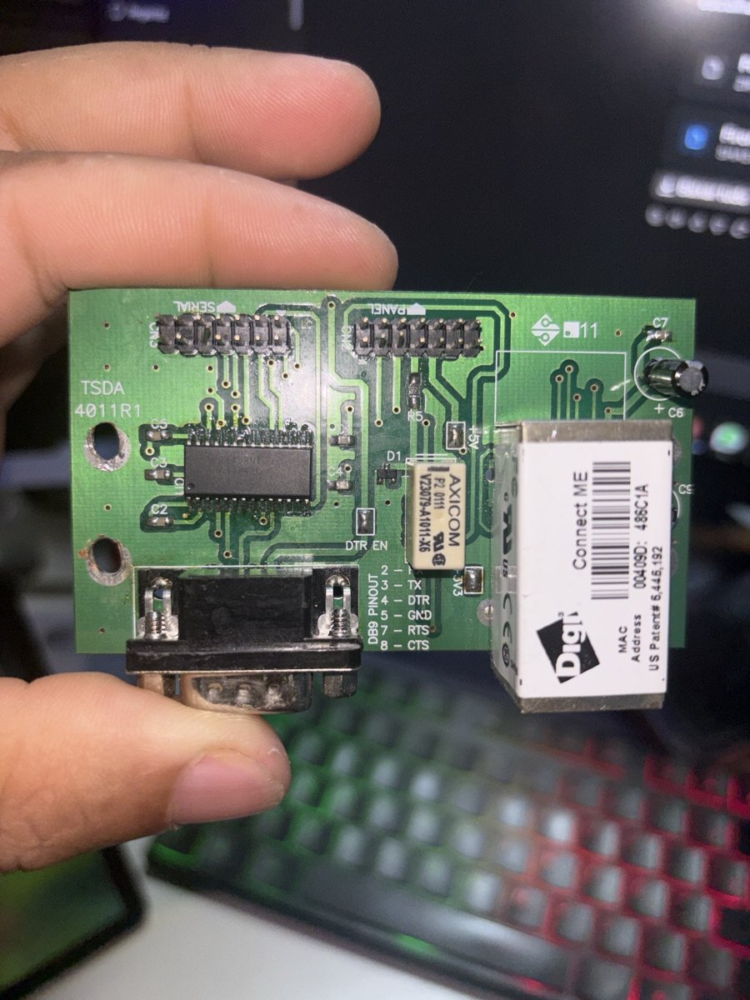
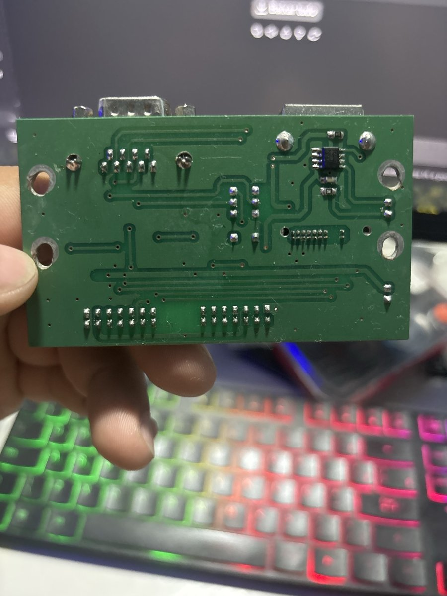

# TSDA 4011R1 — engenharia reversa

Placa de comunicação da remota FLEX TSDA: coloca uma porta serial na rede. O equipamento fala por serial e quem está do
outro lado acessa por IP (página web, Telnet ou túnel TCP) através de um **Digi Connect ME**. Ela também tem um relé de
contato seco. No COMEL ela é a interface de rede do Commodore.

🧊 Modelo 3D reconstruído das fotos: [`3d/tsda-4011r1.html`](3d/tsda-4011r1.html) (abre offline) ·
[`3d/tsda-4011r1.glb`](3d/tsda-4011r1.glb)

| Frente | Verso |
|:---:|:---:|
|  |  |

## Caminho do sinal

1. A rede chega no RJ-45 do **Digi Connect ME** (Ethernet 10/100, NS7520 ARM7 55 MHz, 8 MB RAM, 2 MB flash).
2. O Digi converte TCP/IP em serial **TTL 3,3 V** (TX, RX, RTS, CTS, DTR).
3. O **MAX3243C** (TI, SOIC-28: 3 drivers, 5 receivers) converte TTL em **RS-232** (≈ ±5,5 V) com bomba de carga (C1–C4).
4. A serial sai no **DB9 macho** (pinagem de DTE) e no header interno **CN3 SERIAL** (2×7).
5. Os **+5 V** chegam pelo header e o **TPS7333Q** (verso, SOIC-8, 3,3 V / 500 mA, reset de 200 ms) gera os 3,3 V.
   O 1R0 em série com o capacitor de saída e o 274 (270 kΩ) de pull-up do RESET batem com o circuito de aplicação da TI.

## Pinagem do DB9 (serigrafia)

| Pino | Sinal | Sentido |
|:---:|---|---|
| 2 | RX | entra |
| 3 | TX | sai |
| 4 | DTR | sai (ponte DTR EN fechada) |
| 5 | GND | — |
| 7 | RTS | sai |
| 8 | CTS | entra |

Pinagem da COM de um PC: para ligar num PC use cabo null-modem; num equipamento DCE, cabo reto.

## Outras peças

| Ref. | Peça | Função |
|---|---|---|
| K1 | Axicom P2 V23079-A1011-X6 (TE) | relé de sinal, 2 contatos reversíveis, 2 A / 220 Vcc — contato seco |
| D1 | SOT-23 | provável diodo de roda livre da bobina do relé |
| CN2 | PANEL 2×7 | provável entrada de +5 V/GND e linhas do painel (contatos do relé) |
| DTR EN, +5V, 3V3 | pontes de solda | habilitação do DTR e seleção de alimentação (todas fechadas) |
| C6 | eletrolítico | reserva de energia da entrada de 5 V |

## A conferir na placa real

- Se o **CN3** entrega TTL ou RS-232, e a pinagem dele (decide se a placa COMEL usa J3 ou o MAX3232 + J4).
- A pinagem do **CN2** (de onde vem o +5 V — define o cabo do J11 da placa COMEL).
- Quem aciona o relé (GPIO do Digi ou DTR) e a tensão da bobina.
- Medidas: cerca de 83 × 47 mm, estimadas pelas fotos.
