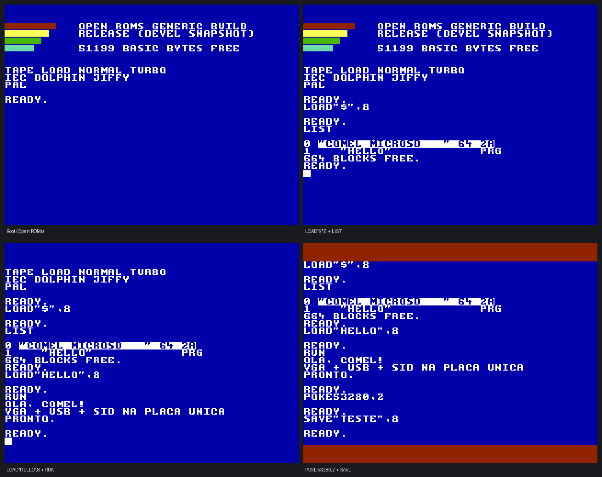

# Firmware — COMEL (Raspberry Pi Pico 2)

Commodore 64 PAL completo rodando no RP2350 da placa COMEL:

| | Como funciona | Onde |
|---|---|---|
| **6510, VIC-II, CIAs** | Núcleo do [Teensy64](https://github.com/FrankBoesing/Teensy64) (Frank Bösing), na versão adaptada para o Pico pelo [MCUME](https://github.com/Jean-MarcHarvengt/MCUME). Roda no núcleo 0, uma linha de varredura por vez, a 50 Hz | [`core/`](core) |
| **SID** | reSID (Dag Lem), saída de 16 bits. Roda no núcleo 1 | [`core/reSID`](core/reSID) |
| **VGA** | 640×480 a 60 Hz, quadro de 320×240 em RGB332 dobrado. Três máquinas de estado no PIO2 (HSYNC, VSYNC, RGB) e dois canais de DMA que percorrem uma lista de linhas em anel — a CPU não participa da varredura. GP6–GP13 cor, GP14 HSYNC, GP15 VSYNC | [`src/vga.pio`](src/vga.pio), [`src/vga.c`](src/vga.c) |
| **2 × USB host** | [Pico-PIO-USB](https://github.com/sekigon-gonnoc/Pico-PIO-USB) + TinyUSB no PIO0. USB 1 = GP4/GP5 (porta de baixo do J2), USB 2 = GP2/GP3 (porta de cima). Teclados em modo boot; hub USB também funciona | [`src/usb_host.c`](src/usb_host.c) |
| **Teclado** | Mapeamento simbólico ABNT2 (ou US): a tecla impressa vira a tecla do C64 que dá o mesmo caractere | [`src/keyboard.c`](src/keyboard.c) |
| **Joystick** | DB9 da placa (GP21/22/26/27/28) na porta 2; F10 troca de porta. Também dá para usar o teclado numérico | [`src/comel_c64.cpp`](src/comel_c64.cpp) |
| **Áudio** | PWM de 10 bits a 246 kHz no GP20; DMA a 32 kHz com dois blocos de 512 amostras | [`src/audio.c`](src/audio.c) |
| **microSD** | SPI0 (GP16–GP19) + FatFs. `LOAD"$",8` lista a pasta `/c64`, `LOAD"NOME",8` / `SAVE"NOME",8` leem e gravam `.prg` | [`src/sdcard.c`](src/sdcard.c), [`src/comel_c64.cpp`](src/comel_c64.cpp) |
| **ROMs** | Vem com as [Open ROMs](https://github.com/MEGA65/open-roms) do MEGA65 (LGPL-3+). As originais, se estiverem no cartão, têm prioridade | [`src/roms.cpp`](src/roms.cpp) |

O RP2350 roda a **252 MHz** (10 × 25,2 MHz do pixel VGA e 21 × 12 MHz do USB) e o programa inteiro é copiado para a RAM
no boot. Usa 457 KB dos 520 KB de RAM.

## Gravar no Pico 2

1. Segure o botão **BOOTSEL** do Pico e ligue o cabo USB do Pico no computador (a placa pode estar desligada).
2. Aparece um disco `RP2350`. Copie para ele o arquivo [`bin/comel.uf2`](bin/comel.uf2).
3. O Pico reinicia sozinho no C64.

## Cartão microSD

Formate em FAT32 (ou exFAT) e crie a pasta `/c64`:

```
/c64/
  jogo.prg            programas (o nome no C64 é o nome do arquivo sem o .prg)
  basic.bin           opcional — BASIC original (8 KiB, 901226-01)
  kernal.bin          opcional — KERNAL original (8 KiB, 901227-03)
  chargen.bin         opcional — caracteres originais (4 KiB, 901225-01)
```

Sem as ROMs originais o C64 liga com as Open ROMs, que são livres mas ainda incompletas. Por exemplo, o `PEEK` do
BASIC delas responde `NOT IMPLEMENTED ERROR`. Jogos em linguagem de máquina rodam bem; para BASIC e compatibilidade
total, use as ROMs originais da Commodore — elas têm direitos autorais, então o projeto não pode distribuí-las.

`LOAD` e `SAVE` nos dispositivos 1 e 8 vão para o cartão (não há emulação do drive 1541 nem de `.d64`):

```basic
LOAD"$",8          lista a pasta /c64
LIST
LOAD"JOGO",8,1     carrega no endereço do arquivo
LOAD"J*",8         o primeiro arquivo que começa com J
SAVE"TESTE",8      grava /c64/teste.prg (substitui se existir)
```

## Teclas

| Teclado USB | C64 |
|---|---|
| Esc | RUN/STOP |
| Tab | CTRL |
| Ctrl, Windows | C= |
| Backspace, Delete | INST/DEL |
| Insert | INST |
| Home / End | CLR/HOME / CLR |
| Setas | cursores |
| F1–F8 | F1–F8 (F2 = Shift+F1 …) |
| Page Up | RESTORE |
| F9 | digita `LOAD"$",8` e `LIST` |
| Shift+F9 | digita `LOAD"*",8,1` e `RUN` |
| F10 | troca o joystick de porta (2 ⇄ 1) |
| Num Lock | liga/desliga o joystick no teclado numérico (8 4 6 2, diagonais 7 9 1 3, tiro 0/5/Enter) |
| F12 | reset |

O layout padrão é **ABNT2**. Para teclado americano, troque `KBD_LAYOUT=KBD_LAYOUT_ABNT2` por `KBD_LAYOUT_US` no
[`CMakeLists.txt`](CMakeLists.txt).

## Compilar

```bash
sudo apt install cmake ninja-build gcc-arm-none-eabi libnewlib-arm-none-eabi libstdc++-arm-none-eabi-newlib
bash scripts/deps.sh                 # pico-sdk 2.2.0 + Pico-PIO-USB 0.7.3 em deps/
cmake -B build -G Ninja
cmake --build build                  # → build/comel.uf2
```

Para usar um pico-sdk que já esteja instalado, exporte `PICO_SDK_PATH` e passe `-DPICO_PIO_USB_PATH=...`.

## Testar no PC, sem a placa

[`tests/host`](tests/host) compila o mesmo emulador para Linux, troca o hardware por imitações (a VGA vira um arquivo de
imagem, o microSD vira uma imagem FAT) e roda um roteiro:

```bash
cmake --build build                  # gera o cabeçalho das Open ROMs
cd tests/host && ./build.sh && python3 make_sd.py && ./comel_host
```

O roteiro liga o C64, digita pelo mesmo caminho dos relatórios USB do teclado ABNT2, faz `LOAD"$",8`, `LIST`,
`LOAD"HELLO",8` e `RUN`, toca uma nota no SID, grava um `SAVE` no cartão e confere o tiro do joystick. As telas ficam em
`tests/host/out/`.

<p align="center"></p>

No PC o emulador roda cerca de 64× mais rápido que o C64 real e o reSID cerca de 285×. É só uma estimativa, mas
indica folga no RP2350 a 252 MHz. A medida de verdade só sai com a placa.

## O que ainda falta

- **Rede pela TSDA:** a UART0 (GP0/GP1) já está ligada ao Digi Connect ME na placa, mas o firmware ainda não a usa.
  O próximo passo é ligar a RS-232 do userport (dispositivo 2 do KERNAL) à UART0 para conversar por Telnet.
- **Drive 1541 e imagens `.d64`.**
- **Joystick e mouse USB** (hoje só teclados são reconhecidos nas portas USB).
- Bordas laterais: a imagem tem 320 pixels de largura, então só aparecem as bordas de cima e de baixo.

## Licenças

O firmware é GPL-3.0, como o resto do projeto. Componentes de terceiros: [`THIRD_PARTY.md`](THIRD_PARTY.md).
